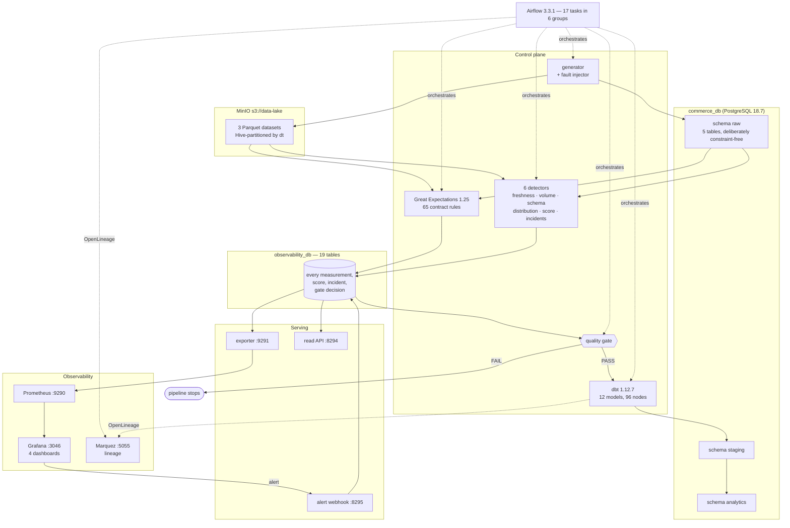
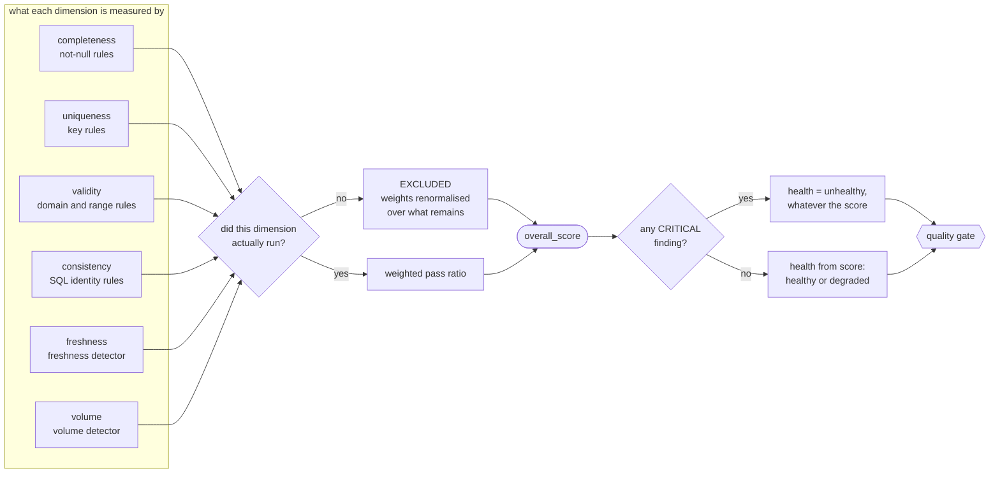
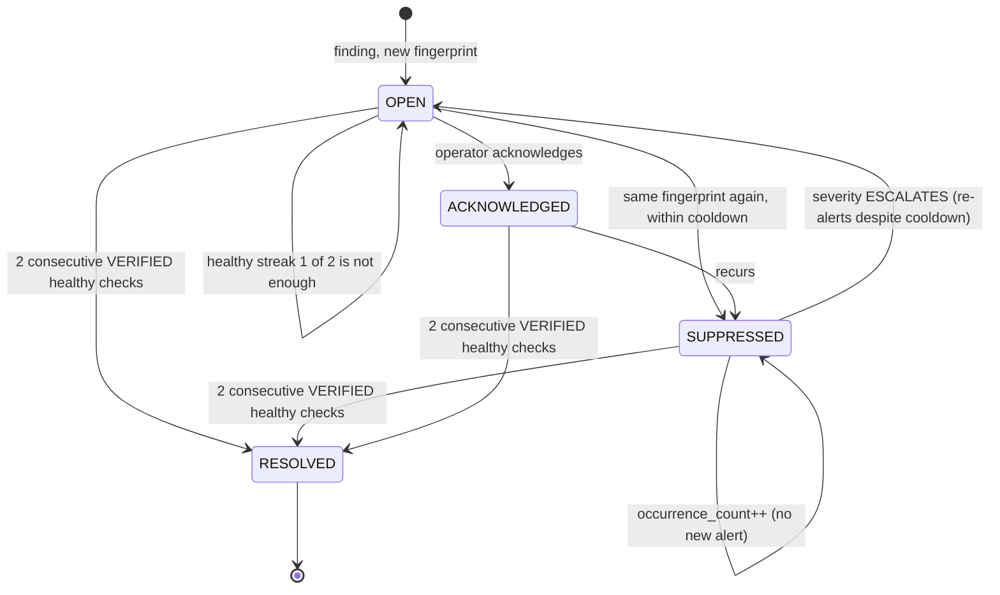
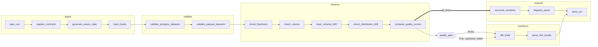
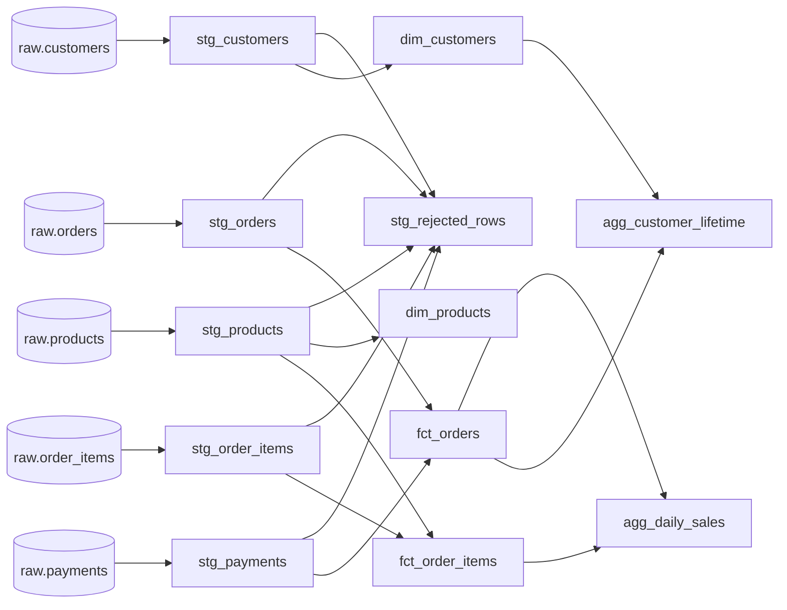
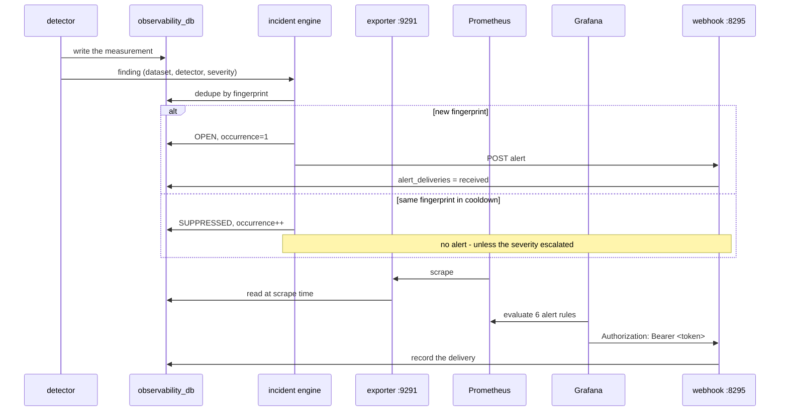

# Centralized Data Quality & Observability Platform

A working data-quality control plane for a small analytics warehouse: declarative
data contracts, Great Expectations validation, six independent detectors, robust
statistical anomaly detection, a quality gate that genuinely blocks a dbt build,
incident lifecycle management, OpenLineage lineage emitted by the tasks that
actually ran, Prometheus metrics and four provisioned Grafana dashboards.

Everything runs locally with `docker compose`. Every number in this README was
measured by running the platform; none is illustrative.

```
8 datasets · 8 contracts · 65 quality rules · 6 detectors · 17 Airflow tasks
12 dbt models · 96 dbt nodes · 4 dashboards · 30 panels · 6 alert rules
186 tests passing · 25 fault scenarios across 9 fault families
```

---

## Table of contents

| | | |
|---|---|---|
| [1. What problem this solves](#1-what-problem-this-solves) | [11. Volume](#11-volume) | [21. OpenLineage and Marquez](#21-openlineage-and-marquez) |
| [2. Design principles](#2-design-principles) | [12. Schema drift](#12-schema-drift) | [22. Prometheus metrics](#22-prometheus-metrics) |
| [3. Architecture](#3-architecture) | [13. Distribution drift](#13-distribution-drift) | [23. Grafana dashboards](#23-grafana-dashboards) |
| [4. Technology matrix](#4-technology-matrix) | [14. Anomaly detection](#14-anomaly-detection) | [24. Alerting](#24-alerting) |
| [5. Quick start](#5-quick-start) | [15. Quality scoring](#15-quality-scoring) | [25. The read API](#25-the-read-api) |
| [6. Repository layout](#6-repository-layout) | [16. Incident lifecycle](#16-incident-lifecycle) | [26. Fault injection](#26-fault-injection) |
| [7. The data under test](#7-the-data-under-test) | [17. The quality gate](#17-the-quality-gate) | [27. Testing](#27-testing) |
| [8. Data contracts](#8-data-contracts) | [18. The Airflow DAG](#18-the-airflow-dag) | [28. Measured results](#28-measured-results) |
| [9. Validation](#9-validation-with-great-expectations) | [19. dbt transformation](#19-dbt-transformation-layer) | [29. Defects found by running it](#29-defects-found-by-running-it) |
| [10. Freshness](#10-freshness) | [20. The platform database](#20-the-platform-database) | [30. Known limitations](#30-known-limitations) |

Operational detail lives in [docs/OPERATIONS.md](docs/OPERATIONS.md); the security
posture, including what is deliberately absent, is in
[docs/SECURITY.md](docs/SECURITY.md).

---

## 1. What problem this solves

A warehouse that is only tested by dbt tests fails late and silently. `dbt build`
runs, a test fails, the model is already built, and the only record is a red line
in a CI log that nobody correlates with last week's red line.

This platform sits **in front of** the transformation and answers four questions
that dbt tests structurally cannot:

| Question | Why dbt tests cannot answer it |
|---|---|
| Is the data **fresh**? | A dbt test sees the rows that are there, not the rows that never arrived |
| Has the **volume** changed? | Needs a baseline across previous runs, which a per-run assertion has no access to |
| Has the **schema** changed? | A test defined against a column that vanished simply errors |
| Has the **distribution** shifted? | Every value can be individually valid while the mix has moved |

And it answers a fifth question that is organisational rather than technical:
**is this the same problem as yesterday?** A detector that re-reports an unchanged
fault every run is noise; this one deduplicates by fingerprint, counts
occurrences, suppresses repeat alerts and refuses to close an incident until it has
seen two consecutive *verified healthy* measurements.

The dbt layer is still here, and still has 96 nodes of its own tests. The point is
that it runs **after** a gate that can stop it.

---

## 2. Design principles

These are the rules the code is written to, and most of them exist because
violating them produced a wrong answer during development.

**A measurement is not a conclusion.** `row_count` is something observed;
`status` is what the platform decided from it. Confusing the two deadlocked the
volume baseline for 104 consecutive checks (§29).

**Not measured is never the same as fine.** An unmeasured dimension is excluded
from the quality score and the remaining weights are renormalised. Scoring it as
100 would mean a check that failed to run *improved* the score.

**A critical failure is never healthy.** `health_status` is independent of
`overall_score`, so 99.92 with a critical breach reads `unhealthy`. The database
enforces it too (`ck_critical_is_not_healthy`), so a bug in the scoring code
cannot write the contradiction.

**A small sample proves nothing.** Below the contract's `min_sample_size` the
drift test is not run at all: status `inconclusive`, `is_significant = false`, and
no statistic published. A PSI of 0.9 on 20 rows is noise.

**A rename is a candidate, never a fact.** Confidence is capped at 0.85 and
`is_confirmed` is always false. A column removal plus a column addition *looks*
like a rename and sometimes is not.

**An incident closes only on evidence.** Silence is not recovery. Resolution
requires two consecutive healthy measurements from a detector that actually ran.

**Nothing is published that was not measured.** No hardcoded lineage diagram
presented as live, no statistic from a test that did not run, no freshness series
for a dataset with no usable timestamp (a zero would read as perfectly fresh).

---

## 3. Architecture



Two databases, deliberately: `commerce_db` is the system under test and
`observability_db` is the platform's own record. A quality platform that stores
its findings in the database it is judging cannot report on an outage of that
database.

---

## 4. Technology matrix

Every version was checked against the registry before it was pinned, and the
combination was then actually resolved and run. Image tags are pinned too.

| Component | Pinned version | Note |
|---|---|---|
| Great Expectations Core | `great-expectations[postgresql]==1.25.0` | Current Data Context → Data Source → Batch Definition → Suite → Validation Definition → Checkpoint workflow, **not** the deprecated 0.18 API. Runtime-tested against pandas 3.0.5 |
| Apache Airflow | `apache/airflow:3.3.1-python3.12` | TaskFlow API via `airflow.sdk`, SimpleAuthManager, separate `dag-processor` |
| OpenLineage provider | `apache-airflow-providers-openlineage==2.21.0` | Image ships 2.20.0; a pure minor bump, all floors satisfied |
| openlineage-python | `1.52.0` | Airflow 3.3.1's own constraint value. PyPI has 1.55.0 — deliberately not used, to avoid moving a constrained pin |
| Postgres provider | `apache-airflow-providers-postgres==7.0.1` | The value in Airflow 3.3.1's constraint file |
| dbt | `dbt-core==1.12.7` + `dbt-postgres==1.11.0` | Decoupled adapter versioning; installed into an **isolated venv** (see below) |
| Marquez | `marquezproject/marquez:0.51.1` + `marquez-web:0.51.1` | 91 Flyway migrations apply against PostgreSQL 18.7 |
| Prometheus | `prom/prometheus:v3.16.0` | |
| Grafana | `grafana/grafana:13.3.1` | Datasources, dashboards and alerting all provisioned from files |
| PostgreSQL | `postgres:18.7-trixie` | Volume at `/var/lib/postgresql`, `PGDATA=/var/lib/postgresql/18/docker` |
| MinIO | `bitnamilegacy/minio:2025.7.23-debian-12-r5` | `minio/minio` on Docker Hub currently publishes no tags at all, so the Bitnami legacy image is used |
| Python | `python:3.12.16-slim-trixie` | Matches the Airflow image's 3.12 minor |
| Test tooling | pytest 9.2.0, pytest-cov 7.1.0, pytest-timeout 2.4.0, freezegun 1.5.5, ruff 0.17.6 | |

### The one real dependency conflict, and why dbt is in its own venv

A pip dry-run inside `apache/airflow:3.3.1-python3.12`, diffed against the image's
own `pip freeze`, showed that installing GX + dbt + OpenLineage + prometheus-client
+ faker changes exactly three things — and two of them are unwanted:

```
apache-airflow-providers-openlineage  2.20.0 -> 2.21.0   (intended)
more-itertools                        11.1.0 -> 10.8.0   (unwanted)
pathspec                              1.1.1  -> 1.0.4    (unwanted)
```

`dbt-core 1.12.7` and `dbt-common 1.39.0` both require `pathspec<1.1,>=0.9`, while
Airflow 3.3.1 pins `pathspec==1.1.1` — **and Airflow uses pathspec to evaluate
`.airflowignore`**. pip reports *no conflict* for that downgrade, which is exactly
why it is worth preventing deliberately rather than discovering later.

dbt therefore installs into `/opt/dbt-venv`, and the Dockerfile **asserts the
isolation held**: Airflow's `pathspec` must still be `1.1.x` and
`find_spec('dbt')` must be `None` in Airflow's interpreter, or the build fails.
Great Expectations needs no isolation — it is purely additive, because every
shared pin in `platform.txt` is set to exactly Airflow's constrained value.

---

## 5. Quick start

```bash
cp .env.example .env
```

Replace every `change_me` value — `scripts/start.sh` refuses to start otherwise.

```bash
./scripts/start.sh
```

```bash
./scripts/start.sh --dev
```

The full stack needs about **10 GiB** of Docker memory. `--dev` runs the whole
data-quality workflow in about **6 GiB**, without Marquez, Prometheus, Grafana,
the API, the exporter or the webhook.

```bash
./scripts/health_check.sh
```

Then open Airflow at <http://localhost:8293> and trigger
`centralized_data_quality_pipeline`, or run the pass directly:

```powershell
docker compose exec dq-api python -m src.observability.cli --date 2026-11-28
```

To watch it fail on purpose, trigger the DAG with
`{"fault_profile": "missing_values"}`.

All 11 host ports, the reduced-profile contents, and troubleshooting for every
failure mode encountered during development are in
[docs/OPERATIONS.md](docs/OPERATIONS.md).

---

## 6. Repository layout

```
contracts/            8 YAML data contracts — 65 rules, 108 declared columns
sql/
  source/             raw schema (constraint-free by design) + dbt schemas
  platform/           00_init.sh (roles/databases) + 19-table observability schema
src/
  common/             config, db, logging, severity, storage, run context
  generator/          deterministic data generator + 25-scenario fault injector
  contracts/          contract models, strict loader, registry, non-GX rule engine
  validation/         GX context, suite builder, runner, persistence, CLI
  observability/      freshness, volume, schema_tracker, distribution,
                      quality_score, incidents, anomaly, persistence, tasks, CLI
  gates/              the quality gate
  dbt_runner/         dbt invocation + artifact parsing
  lineage/            OpenLineage emitter
  metrics/            Prometheus collectors + exporter
  api/                read API (FastAPI)
  webhook/            alert receiver
dbt/                  12 models, 11 singular tests, 3 macros
airflow/dags/         centralized_data_quality_pipeline.py — 17 tasks, 6 groups
grafana/              provisioning (datasources, dashboards, alerting) + 4 dashboards
prometheus/           scrape config
marquez/              custom Marquez config
docker/               two Dockerfiles + pinned requirements
scripts/              start, stop, health_check, run_tests, minio_init,
                      build_dashboards, verify_dashboards
tests/                unit (132) · integration (41) · e2e (13) = 186
docs/                 OPERATIONS.md, SECURITY.md, screenshots/
```

52 Python modules, about 12,000 lines in `src/`, about 3,000 in `tests/`.

---

## 7. The data under test

A small e-commerce warehouse, generated deterministically so that every result in
this README is reproducible.

| Dataset | Store | Rows (default load) |
|---|---|---|
| `raw.customers` | PostgreSQL | 10,000 |
| `raw.products` | PostgreSQL | 1,000 |
| `raw.orders` | PostgreSQL | 50,000 |
| `raw.order_items` | PostgreSQL | 102,557 |
| `raw.payments` | PostgreSQL | 55,823 |
| `daily_sales` | Parquet on MinIO | 20 |
| `inventory_snapshots` | Parquet on MinIO | 1,000 |
| `customer_activity` | Parquet on MinIO | 9,950 |

A full load takes **7.1 s**. Determinism is proven, not assumed: seed 42 twice
produces the identical SHA-256 `10e2e8bc75ac7631…`, and seed 43 produces a
different one.

Those counts are for the partition date they were measured on. The generator
applies a weekday volume curve, so a quieter day produces proportionally fewer
orders and items — a load on a different date legitimately reports, for example,
49,000 orders instead of 50,000. That curve is why the volume baseline compares
like with like (`same_day_type`), and `--no-weekday-weighting` turns it off when
an exact count is wanted.

The `raw` schema carries **no** `NOT NULL`, `UNIQUE`, `FK` or `CHECK` on any
business column; the only key is `ingestion_id GENERATED ALWAYS AS IDENTITY`. That
is the opposite of a hardening recommendation and it is the point: the platform's
job is to *detect* bad data, so bad data has to be able to land, and a duplicate
source row has to survive as a duplicate.

Clean data was verified internally consistent by SQL independently of the
contracts: 0 nulls in key columns, 0 duplicate natural keys, 0 orphans across four
joins, 0 invalid enum/price/quantity/email/state values, 0 line-total identity
violations, 0 order-total violations, 0 settled-payment violations.

---

## 8. Data contracts

Each dataset has one YAML contract that is the single source of truth for what
"correct" means. Nothing about quality is hardcoded in Python.

```yaml
dataset: raw.orders
version: "1.0.0"
criticality: critical

source:
  type: postgres
  location: raw.orders
  # order_date is the business event time; _ingested_at is when the pipeline
  # saw the row. Freshness prefers the event time, so an upstream that keeps
  # delivering old orders is visible even while the loads keep running.
  event_timestamp_column: order_date
  ingestion_timestamp_column: _ingested_at

freshness:
  warning_after_minutes: 180
  critical_after_minutes: 720
  on_missing_timestamp: CRITICAL

volume:
  baseline:
    method: rolling_median_mad
    window_days: 28
    min_history_points: 5
    warning_z: 3.5
    critical_z: 6.0
    # Orders are materially quieter at weekends, so the baseline compares a
    # Saturday with other Saturdays.
    same_day_type: true

schema:
  on_additive: INFO
  on_type_change: CRITICAL
  on_column_removal: CRITICAL
  on_rename_candidate: ERROR
```

8 contracts, **65 rules**, 108 declared columns. Each rule carries a dimension
(one of completeness, uniqueness, validity, consistency, freshness, volume) and a
severity (INFO / WARNING / ERROR / CRITICAL).

### The loader is strict on purpose

A contract that cannot be understood is rejected at load time rather than
silently half-applied. Rejected: unknown keys, invalid severities, dimensions
outside the six, scoring weights that do not sum to 1.0, `critical_z` below
`warning_z`, and drift columns that are absent from the declared schema.

The version checksum is computed over **normalised** content, so editing a
contract without bumping its version still registers as a new version row. The
alternative — trusting the author to remember — means the platform's history
quietly stops matching the rules that produced it.

### Comments in the contracts carry the reasoning

The contracts are the place where a decision and its reason live together. For
example, `raw.customers` and `raw.products` deliberately do **not** declare an
event timestamp, and the YAML says why: for slowly changing reference data what
matters is when it was last *refreshed*, not the age of the newest business
record. That is in §29 as a defect, because measuring it the other way reported
CRITICAL on a perfectly healthy catalogue.

---

## 9. Validation with Great Expectations

GX Core 1.25.0, current workflow throughout:

```
Data Context → Data Source → Data Asset → Batch Definition
             → Expectation Suite → Validation Definition → Checkpoint
```

Rule names map dynamically: a snake_case contract rule becomes the matching
CamelCase class in `great_expectations.expectations` (61 classes available). There
is no hardcoded rule table to fall out of date.

### What GX could and could not express

**`UnexpectedRowsExpectation` carries the interesting half.** `{batch}` *is*
substituted, and cross-table joins to other tables in the same database work, so
referential integrity and the financial identities are expressed as SQL — no
column expectation can state "every order_item points at an order that exists".

**Parquet goes through the real file-based `pandas_s3` datasource**, not a
dataframe workaround. Three things had to be measured rather than assumed:

* `s3_recursive_file_discovery=True` is **required**, or a Hive-style path is
  invisible and `test_connection` fails with "No file in bucket … using delimiter";
* `add_batch_definition_path(path=...)` is **relative to `s3_prefix`** — passing
  the full key raises `PathNotFoundError` for an object that is plainly there;
* `boto3_options` carries `endpoint_url` and the keys for MinIO.

**`ExpectMulticolumnSumToEqual` takes a scalar `sum_total`**, so it cannot express
`a = b - c`. The three Parquet consistency rules therefore use a `pandas_query`
rule type that the contract engine evaluates directly, because the pandas
execution engine cannot run SQL. 62 of the 65 rules are GX expectations; 3 are
engine rules.

### The measurement that shaped a rule

A naive "sum of all payments equals `total_amount`" rule raises **3,265 false
positives out of 50,000 orders**, because clean data legitimately contains 3,265
refund rows. Scoping the rule to non-refund payments gives 0. That count, and the
reason, are written into `contracts/raw_orders.yml` next to the rule.

Clean data: **65 rules, 65 passed, 0 failed** across all 8 datasets
(`raw.orders`: 13 rules over 50,000 rows in 357 ms).

---

## 10. Freshness

Freshness asks "how old is the newest thing here", and the hard part is *which
clock*.

Each contract names an event timestamp, an ingestion timestamp, or both. The
detector prefers the event time where one exists, so an upstream that keeps
delivering stale orders is visible even while the loads themselves keep running.
Where there is no event time it falls back to ingestion time. **The clock it used
is recorded on every row** (`timestamp_source`), because a lag figure without its
clock is not interpretable.

Verified behaviour on one clean run: `raw.order_items` has no event timestamp and
reported `ok` via ingestion time (lag 444 s), while the transaction tables
reported CRITICAL via event time (lag ~90,000,000 s) because the generated data is
dated 2024-01-15 and the run was in 2026. That is correct — normal operation
generates for the logical date — and it is the reason the dataset's chosen clock
is stored alongside the number.

`on_missing_timestamp` decides what happens when the contract names a column that
the data does not have: the default is CRITICAL, because an unmeasurable dataset is
worse than a stale one, not better.

---

## 11. Volume

Row counts with a **robust** baseline: rolling median and median absolute
deviation over a 28-day window, with a robust z-score

```
z = 0.6745 * (count - median) / MAD
```

Mean and standard deviation would be wrong here: one genuine outage inflates the
standard deviation enough to hide the next one. The median and MAD do not move.

`same_day_type: true` compares a Saturday with other Saturdays. Without it, the
generator's own weekend curve reports as a 40 % volume incident every weekend.

With fewer than `min_history_points` comparable observations the status is
`unknown`, method `insufficient_history` — the platform does **not** invent a
threshold from one data point.

Measured on a real spike injection: **49,000 → 98,000 rows, robust z = 67.45,
+100.0 %, status critical, severity CRITICAL, gate FAIL.**

---

## 12. Schema drift

Every run snapshots the observed schema — name, type, nullability, ordinal
position — and diffs it against the previous snapshot. Changes are classified and
each class has a contract-configured severity:

| Change | Default severity | Reasoning |
|---|---|---|
| `ADDITIVE` | INFO | A new column breaks nothing downstream |
| `TYPE_CHANGE` | CRITICAL | Silently breaks arithmetic and comparisons |
| `COLUMN_REMOVAL` | CRITICAL | Everything selecting it fails |
| `COLUMN_RENAME_CANDIDATE` | ERROR | **Never confirmed** — see below |
| `NULLABILITY_CHANGE` | contract | Off by default, see below |
| `POSITION_CHANGE` | INFO | Matters only to positional readers |

### A rename is a candidate, never a fact

A removal plus an addition looks like a rename and sometimes is not. Pairing is
greedy by descending confidence, one claim per column, confidence capped at **0.85
so it can never reach certainty**, and `is_confirmed` is always `false`.

This was not theoretical. With 2 removals against 2 additions, a naive loop
produced **4 candidates for 1 real rename**. The greedy assignment picks
`zip_code → postal_code` at 0.70 (the true rename) and leaves
`phone → loyalty_tier` at 0.60 as a separate, unconfirmed claim.

### Nullability is off by default, deliberately

`schema.check_nullability` defaults to **false**. The raw layer is
constraint-free on purpose, so comparing contract nullability against *physical*
nullability made `raw.customers` report 4 BREAKING changes on a perfectly healthy
run — the platform flagging its own design (§29).

Contract nullability is a statement about the **data**, enforced by the
completeness rules. It is not a statement about the DDL.

---

## 13. Distribution drift

Numeric columns use **PSI**; categorical columns use a **chi-square test of
homogeneity**.

```
PSI = sum over bins of (actual% - expected%) * ln(actual% / expected%)
```

Conventional reading: < 0.1 no real shift, 0.1–0.25 moderate, > 0.25 major. Those
are the contract defaults. Empty bins are floored at a small epsilon so the
logarithm stays finite, and **the floor is reported in the detail** because it
changes the number.

**Bin edges are fixed by the reference** and stored with it. Re-binning each side
independently would compare different buckets and manufacture drift from nothing.

### Both sides are samples

The categorical test is a 2 × k test of homogeneity, not a goodness-of-fit test
against the reference's proportions. The distinction is not academic — the first
implementation got it wrong, and this is what that cost:

| Test | chi-square | df | p | verdict |
|---|---|---|---|---|
| goodness-of-fit against reference proportions | **99.415** | 19 | 6.8e-13 | drift, WARNING |
| 2 × k homogeneity, same two profiles | **9.012** | 19 | 0.973 | no drift |

Both profiles were clean loads of the *same* generator — a uniform 20-category
column with `n_ref = 1,000` and `n_cur = 10,000`. Treating the reference as a
*known* distribution ignores its own sampling error, so its ±7-count noise was
multiplied tenfold and charged to the current sample. Both tests share the same
k−1 degrees of freedom; the homogeneity test simply prices in the uncertainty on
both sides, so a noisy reference *widens* the test rather than sharpening it.

That regression is locked down by
`test_a_small_noisy_reference_does_not_manufacture_drift`, which carries the real
stored counts, alongside a test proving a genuine shift on the same lopsided
1,000-vs-10,000 split is still caught.

### Refusing to conclude

Categories whose smallest expected cell falls below the contract threshold are
pooled into one `__other__` bucket, and the pooling is reported. Below
`min_sample_size` on either side the test is not run: `inconclusive`,
`is_significant = false`, **and no statistic is published** — plotting a number
the platform will not stand behind invites trust it has not earned.

---

## 14. Anomaly detection

The shared statistical core, in `src/observability/anomaly.py`, is used by the
volume baseline and available to any metric in `metric_history`:

* **rolling median + MAD** rather than mean + standard deviation, so one outage
  does not raise the bar for detecting the next one;
* **robust z-score** with the 0.6745 consistency factor, which makes the MAD
  comparable to a standard deviation for normally distributed data;
* **PSI** and **chi-square** for distributions, as above;
* `same_day_type` bucketing, so weekly seasonality is not read as an anomaly.

A MAD of zero (a perfectly constant metric) is handled explicitly rather than
dividing by zero: any deviation from a constant is reported through a relative
change instead, and the method used is recorded.

---

## 15. Quality scoring

A 0–100 score per dataset over the six dimensions, weighted by the contract.



Two rules matter more than the arithmetic:

**Unmeasured dimensions are excluded and the weights renormalised.** Verified
numerically: `raw.customers` with volume unmeasured renormalises to
`{completeness 0.333, uniqueness 0.222, validity 0.222, freshness 0.111,
consistency 0.111}` — each original weight divided by 0.90 — giving
`0.80 / 0.90 = 88.89`, with `dimensions_measured = 5/6` and
`unmeasured = ["volume"]` recorded alongside.

Scoring an unmeasured dimension as 100 would mean a check that *failed to run*
improved the score. That is the single most common way a quality dashboard starts
lying.

**`health_status` is independent of `overall_score`.** In the same verified run
the health was `unhealthy` despite 88.89, because `has_critical_failure` was true.
A 99.92 with a critical breach is `unhealthy`, not "almost perfect". The database
enforces this with `ck_critical_is_not_healthy`, so a scoring bug cannot write the
contradiction even if the Python allowed it.

---

## 16. Incident lifecycle



### Deduplication, measured

Three identical failing passes:

| Pass | Incidents opened | Status | occurrence_count |
|---|---|---|---|
| 1 | 4 | OPEN | 1 |
| 2 | 0 | SUPPRESSED | 2 |
| 3 | 0 | SUPPRESSED | 3 |

One recurring fault is one incident. The cooldown suppresses repeat *alerts* while
still counting occurrences, and an **escalation in severity re-alerts despite the
cooldown** — a WARNING becoming CRITICAL is new information.

### Resolution requires evidence, not silence

Two consecutive **verified** HEALTHY_CHECK events, counted as a streak so a
recurrence resets it. Measured: after a broken run left 5 incidents OPEN, one
healthy pass gave `streak = 1` and resolved **nothing**; the second resolved all
five, each with the reason
`resolved after 2 consecutive verified healthy measurements`.

"Verified" is load-bearing. `record_healthy()` is called only when a detector
actually ran and passed. A run that did not measure a dataset writes nothing, so
the incident stays open. `_detectors_that_ran()` excludes freshness and volume
with status `unknown`, distribution where every result was `inconclusive`, and
scoring where health is `unknown` — so **"not measured" can never masquerade as
"measured and fine"**.

The database backs this up: `ck_resolved_consistency` rejects a RESOLVED incident
with a NULL `resolved_at`, and `ux_incidents_active_fingerprint` (a partial unique
index over OPEN / ACKNOWLEDGED / SUPPRESSED) rejects two live incidents sharing a
fingerprint while still allowing a resolved one to coexist with a new live one.

---

## 17. The quality gate

One decision, recorded with its reason:

| Condition | Decision |
|---|---|
| any CRITICAL finding | **FAIL** |
| ERROR on a dataset configured as blocking | **FAIL** |
| highest severity above INFO | **PASS_WITH_WARNINGS** |
| everything within contract | **PASS** |

A CRITICAL breach always fails, regardless of score — the pipeline stops rather
than publishing data the contracts reject. `ck_critical_fails_gate` rejects a
`PASS` row with a non-zero critical count, so the gate cannot record a decision
that contradicts its own inputs.

`PASS_WITH_WARNINGS` exists because a platform with only two outcomes gets its
thresholds loosened until it never fires. A WARNING continues downstream work and
records the finding.

The gate is wired as a **data dependency**, not a visual one — see §18 for why
that distinction cost a real bug.

---

## 18. The Airflow DAG



17 tasks in 6 TaskGroups, Airflow 3.3.1 TaskFlow API (`airflow.sdk`).

Two wiring decisions are the whole point of the diagram:

**`transform` is gated; `respond` is not.** `respond` depends on `observe` with
`trigger_rule="all_done"`, so incidents are opened and alerts dispatched *even
when the gate fails* — precisely when both matter most. Only the dbt build is
blocked.

**Every stage takes the previous stage's result as an argument.** Chaining task
groups with `>>` on the returned `XComArg` constrains only that one leaf task, and
that is not a style preference: it let **dbt run while five upstream tasks had
failed** (§29).

### Proven both ways

| Run | DAG state | Gate | dbt | Platform status | Incidents | Alerts |
|---|---|---|---|---|---|---|
| clean | **success** (17 ok, 0 fail) | PASS | built | `success` | 0 | 0 |
| `{"fault_profile": "missing_values"}` | **failed** | FAIL | `upstream_failed` | `blocked` | **7 CRITICAL** | **7 received** |

In the fault run the three affected datasets read **99.92 / 91.44 / 99.99 and
`unhealthy`** — the "a critical failure is never healthy however high the score"
rule holding inside the real pipeline, not just in a unit test.

The run is recorded as `blocked`, **not** `failed`: the platform worked correctly
and stopped the pipeline on purpose. Those are different facts and the dashboards
distinguish them.

---

## 19. dbt transformation layer



12 models (6 staging, 6 analytics), 11 singular tests, 73 generic tests.
`dbt build` → **PASS = 96, ERROR = 0, SKIP = 0 in 4.25 s**.

`stg_rejected_rows` is the model that makes the staging layer honest: rows that
fail a staging predicate are routed there rather than silently dropped, so
`raw → staging` is provably 1:1 and the rejects are countable. It is 0 on clean
data.

### Output correctness verified independently of dbt's own tests

A green dbt run is evidence that the assertions passed, not that the numbers are
right. So the warehouse totals were checked against the raw source directly:

| Check | Warehouse | Raw source | Match |
|---|---|---|---|
| `agg_daily_sales` net revenue | **54,978,807.44** | `sum(line_total)` = 54,978,807.44 | exact |
| `fct_orders.net_revenue` | **48,781,610.78** | settled − refunded = 48,781,610.78 | exact |
| `was_refunded` orders | 3,192 | 3,192 refund rows | exact |
| `stg_rejected_rows` on clean data | 0 | raw → staging is 1:1 | — |

### dbt node → dataset attribution is explicit, never inferred

dbt calls it `stg_orders`; the contract calls it `raw.orders`. Guessing from the
name works until it doesn't, so the 5 staging models carry
`config.meta.dq_dataset` and their tests inherit it. **48 of 96 nodes are
attributed**; the analytics layer has no mapping and is recorded as `NULL` rather
than guessed. That is a documented limitation (§30), not an omission.

`dbt_runs` keeps model counts and test counts in **separate** columns, because
`models_success = 12` with `tests_fail = 3` is a real and important state: the SQL
ran perfectly and produced data that fails its own assertions.

`macros/get_custom_schema.sql` is required — dbt's default `generate_schema_name`
would build `public_staging` instead of `staging`, where nothing is looking.

---

## 20. The platform database

`observability_db`, **19 tables**, with `pipeline_runs.run_id` as the correlation
parent of everything:

```
datasets · contract_versions · pipeline_runs
validation_runs · validation_results
dbt_runs · dbt_test_results
freshness_checks · volume_checks
schema_snapshots · schema_changes
distribution_profiles · distribution_drift
quality_scores
incidents · incident_events
gate_decisions · alert_deliveries · metric_history
```

Four invariants from the design are enforced by **constraints**, not by code, and
each was negative-tested by attempting the illegal write:

| Attempt | Result |
|---|---|
| `quality_score` with `has_critical_failure = true` and `health_status = 'healthy'` | rejected, `ck_critical_is_not_healthy` |
| `gate_decision` with `critical_count = 1` and `decision = 'PASS'` | rejected, `ck_critical_fails_gate` |
| `incident` `status = 'RESOLVED'` with `resolved_at` NULL | rejected, `ck_resolved_consistency` |
| two live incidents with the same fingerprint | rejected, `ux_incidents_active_fingerprint` |

Both legitimate cases were accepted: critical + unhealthy, and a RESOLVED
incident coexisting with a live one of the same fingerprint.

The whole run is written under one `run_id`, so "what did the platform know at
14:02 on Tuesday" is a single query rather than a reconstruction.

---

## 21. OpenLineage and Marquez

Lineage is **emitted by the tasks that ran**. There is no static diagram presented
as live lineage anywhere in this repository.

The `apache-airflow-providers-openlineage` provider emits START and
COMPLETE/FAIL for every task automatically. On top of that, four tasks emit
explicit dataset-level events so the inputs and outputs are real rather than
inferred from the task name.

Queried through the Marquez API after a run, Marquez genuinely holds:

| Namespace | Contents |
|---|---|
| `postgres://postgres-source:5432/commerce_db` | **16 datasets** — `raw.*` (5), `staging.stg_*` (5), `analytics.*` (6) |
| `s3://data-lake` | **3 datasets**, partitioned: `daily_sales/dt=2026-11-27`, … |
| `postgres://postgres-platform:5432/observability_db` | `validation_runs`, `validation_results` |
| `data-quality-platform` | the **jobs** — 23 at the time of writing, 5 of them carrying explicit inputs and outputs |

The five with dataset-level lineage, exactly as the API reports them:

```
centralized_data_quality_pipeline.generate_source_data        in=8  out=21
centralized_data_quality_pipeline.validate_postgres_datasets  in=5  out=0
centralized_data_quality_pipeline.validate_parquet_datasets   in=3  out=0
centralized_data_quality_pipeline.dbt_build                   in=5  out=0
emitter_smoke_test                                            in=1  out=1
```

`emitter_smoke_test` is there on purpose: it is the direct `emitter.emit(...)`
check that proves the client can reach Marquez at all, which is how the
`schemaURL` defect below was finally pinned down.

Datasets live in namespaces named after their **physical location**, per the
OpenLineage naming spec, not in the DAG's namespace. (I queried the wrong
namespace first and briefly believed the datasets were missing — §29.)

The emitter logs a warning and lets the task continue if an emission fails. A
lineage backend being down should not fail a data-quality run; what it must not do
is fail *silently*, which is exactly how the `schemaURL` defect below was found.

---

## 22. Prometheus metrics

The exporter is a custom `Collector` that reads `observability_db` **at scrape
time**, not a set of module-level gauges.

That is the central design decision. A gauge set during a run keeps its last value
forever, so a dataset that **stopped being checked** would keep reporting its final
healthy score — the monitoring equivalent of a photograph of a smoke detector.
Reading at scrape time means a dataset that is no longer measured stops producing
a series.

Exported, all verified live on `:9291`: quality scores and health per dataset,
freshness lag labelled by `timestamp_source`, row counts, volume z-scores,
incident counts by status and severity, gate decision counters, drift statistics,
and dbt model counts versus test counts.

### Label discipline

Every label comes from a bounded set: `dataset`, `dimension`, `severity`,
`change_type`, a contract-declared `column`, `status`, `decision`,
`timestamp_source`. There is **no** customer, order, run or incident id, and no
error strings — an exception message is unbounded text and would mint a new time
series for every new failure mode, forever.

Two deliberate omissions that could be mistaken for bugs:

* a dataset with no usable timestamp emits **no** freshness series, because zero
  would read as perfectly fresh;
* an `inconclusive` drift test publishes **no** statistic.

---

## 23. Grafana dashboards

Four dashboards, **30 panels**, provisioned from files and generated by
`scripts/build_dashboards.py` so the JSON is reviewable as code:

| Dashboard | Panels | Answers |
|---|---|---|
| **1. Platform Overview** | 11 | Are the datasets healthy right now, is the gate passing, what is the run history |
| **2. Freshness & Volume** | 6 | How old is each dataset, by which clock, and how far is its row count from baseline |
| **3. Schema & Distribution** | 6 | What changed structurally, which columns are drifting and with what statistic |
| **4. Incidents & Reliability** | 7 | What is open, for how long, how often has it recurred, were the alerts delivered |

There are **no dashboard screenshots in this repository**, and
[docs/screenshots/](docs/screenshots/README.md) says why: the stack does not
install `grafana-image-renderer`, no browser was available to capture from, and an
illustrative screenshot in a data-quality project would be the wrong thing to
publish. What is there instead is
[panel-verification.txt](docs/screenshots/panel-verification.txt) — the real
output of the verifier below — plus the steps to capture the images yourself.

### Verifying the panels, rather than looking at them

An empty panel on a quality dashboard looks exactly like "no problems found". That
is the most dangerous failure mode this platform can have, and eyeballing does not
catch it — a panel whose query is correct but whose **result shape** is wrong
renders empty and looks fine.

`scripts/verify_dashboards.py` runs **every** panel target through Grafana's
`/api/ds/query` and classifies each one OK / EMPTY / SHAPE / ERROR. First run:
**18 ok, 6 empty, 1 wrong shape, 5 errored**. Final state: **28 ok, 0 wrong shape,
0 errored**, 2 legitimately empty (no schema change has occurred since the last
reset) with the reason printed.

It also exposed three bugs in itself, each worth keeping as a note:

* `$__timeFilter(col)` has to be expanded to a **boolean predicate**. Replacing
  just the macro name yields `OR (q.computed_at)`, and Postgres answers
  `argument of OR must be type boolean, not type timestamp with time zone`.
* A `\1` backreference in the replacement collapsed to a literal `\x01` byte on
  the way through the shell, giving `syntax error at or near "<0x01>"`. Rewritten
  as a lambda, which sidesteps replacement escaping entirely.
* Prometheus **range** queries return empty frames from `/api/ds/query` when
  `from`/`to` are the relative strings `now-7d`/`now` — those are resolved by the
  dashboard front end. Epoch milliseconds work.

And one false positive it was right to flag and wrong to fail: a `stat` panel with
`textMode: value` renders a string perfectly well, which is how "Last gate
decision" shows `PASS`/`FAIL`.

---

## 24. Alerting



Six provisioned alert rules:

1. Dataset has a CRITICAL data-quality failure
2. Quality score below the degraded threshold
3. Data is critically stale
4. Row count far from its baseline
5. Open CRITICAL incidents
6. Exporter cannot read `observability_db`

The sixth is the one that matters most: it alerts on the **monitoring** failing.
Without it, every other rule silently stops firing when the exporter dies and the
dashboards go quiet, which reads as good news.

Two things learned the hard way:

**Grafana refuses to boot on invalid alerting provisioning.** A
`deleteContactPoints` block removing a contact point that a notification policy
references fails validation and the process exits with
`invalid service state: Failed ... starting module provisioning`. Not a warning —
the container never becomes healthy.

**Grafana sends webhook credentials as `Authorization: <scheme> <credentials>`**,
not as an arbitrary custom header, so the receiver accepts
`Authorization: Bearer <token>` as well as its own `X-DQ-Token`.

---

## 25. The read API

FastAPI on `:8294`. Three endpoints, all exercised against the running stack.

`GET /health` probes `observability_db`, `commerce_db` **and** MinIO, and reports
each separately. A health endpoint that returns one boolean for three dependencies
tells you nothing when it goes false.

`GET /summary` returns the datasets monitored, incident counts by status, the
latest run and the latest gate decision — and lists `datasets_never_measured`
**separately** from the healthy ones, because a dataset nobody has checked is not
a dataset that is fine.

`GET /datasets/{name}` returns the score and health, freshness with its
`timestamp_source`, volume with its baseline method, the schema fingerprint and
the open incidents. An unknown dataset returns **404 with a message naming the
fix**, not an empty object.

---

## 26. Fault injection

25 scenarios across 9 fault families, grouped into 12 profiles. Each scenario
**declares the detector and severity it expects**, so the scenario catalogue is
itself a specification that the E2E suite checks.

```powershell
docker compose exec dq-api python -m src.generator.cli --list
```

| Family | Example scenarios |
|---|---|
| missing values | `null_customer_id`, `null_order_total` |
| duplicates | `duplicate_orders`, `duplicate_payments` |
| referential integrity | `orphan_order_items`, `orphan_payments` |
| range / domain | `negative_product_price`, `zero_quantity`, `invalid_state` |
| financial consistency | `payment_total_mismatch`, `line_total_mismatch` |
| freshness | `stale_ingestion` |
| volume | `volume_spike`, `volume_collapse` |
| schema | `column_removal`, `type_change`, `column_rename` |
| distribution | `category_collapse`, `price_shift` |

Injection-to-detection, with exact counts:

| Injected | Rows | Rule that failed | Unexpected |
|---|---|---|---|
| `null_customer_id` | 40 | `raw.customers/customer_id_not_null` (CRITICAL) | 40 |
| `duplicate_orders` | 120 | `raw.orders/order_id_unique` (ERROR) | 240 (original + copy) |
| `orphan_order_items` | 65 | `raw.order_items/every_item_has_a_known_order` (CRITICAL, SQL) | — |
| `payment_total_mismatch` | 50 | `raw.orders/settled_payments_match_order_total` (CRITICAL, SQL) | — |
| `negative_product_price` | 25 | `raw.products/price_is_positive` (ERROR) | 25 |
| `zero_quantity` | 55 | `raw.order_items/quantity_is_positive` (ERROR) | 55 |

The **cascades** were verified as real rather than dismissed as noise: nulling a
customer key orphans that customer's orders; zeroing a quantity breaks the
line-total identity *and* makes the discount exceed a zero gross; a negative price
inverts `cost_not_above_price`. After restoring clean data: 65 rules, 0 failed.

One scenario declaration was corrected by measurement. `volume_spike` declared
`expected_severity = ERROR`, but 2.5× gives a robust z of 67.45 against a
`critical_z` of 6.0, so the detector correctly escalates to CRITICAL. The declared
severity now matches the magnitude the scenario actually injects — the scenario
was wrong, not the detector.

---

## 27. Testing

```bash
./scripts/run_tests.sh unit          # 132 tests, no services needed
./scripts/run_tests.sh integration   #  41 tests, needs the stack
./scripts/run_tests.sh e2e           #  13 scenarios, needs the stack
./scripts/run_tests.sh all           # with coverage, written to artifacts/
```

**186 passing.** Every test asserts a real outcome — a count, a severity, a
status, a decision — not merely that a function returned.

### Unit (132)

Contract loading and rejection, severity ordering, suite building, the six
detectors' logic, PSI and chi-square, the robust z-score, score renormalisation,
gate decisions, generator determinism.

Including, for example:

* that a 6-decimal weight set summing to 0.999999 is accepted within 1e-5, because
  rounding is not a contract error;
* that quantile bin edges **collapse** rather than producing empty bins when a
  column has only a handful of distinct values, which is the honest outcome;
* that a small noisy reference does not manufacture categorical drift (§13), with
  the real stored counts.

### Integration (41)

Against the live stack: the source layer accepts deliberately corrupt rows, the
19-table schema enforces its four invariants, the API's three endpoints answer
correctly, the webhook's four paths behave, the exporter's series parse, and GX
validation runs end to end.

### End-to-end (13 scenarios)

Each scenario resets to clean, injects **one** fault, runs the real
`src.observability.cli` pass that the DAG runs, and asserts that the **right
detector** caught it at the **right severity** and that the gate did the right
thing. Nothing is simulated.

| # | Scenario | Asserts |
|---|---|---|
| 1 | clean data reports healthy | 8/8 datasets 100.0, healthy, gate PASS |
| 2 | missing values | CRITICAL, gate FAIL |
| 3 | duplicates | uniqueness dimension fails |
| 4 | invalid values | validity dimension fails |
| 5 | referential integrity | the SQL expectation catches the orphans |
| 6 | financial inconsistency | the identity rule fails, refunds excluded |
| 7 | volume spike | caught against its own baseline, not a fixed number |
| 7b | **normal weekend variation** | **not** an anomaly — the false-positive guard |
| 8 | stale data | caught by the right clock |
| 9 | schema drift | classified; a rename stays a candidate |
| 9b | **a small sample** | yields **no** drift claim |
| 10 | recovery | needs two verified healthy rechecks |
| 10b | **an unmeasured dataset** | **never** resolves an incident |

The four scenarios in bold are the ones that test the platform's restraint, and
they are the reason the suite is worth having. A detector that fires on everything
passes scenarios 2–9 perfectly.

---

## 28. Measured results

A clean run, start to finish:

```
8/8 datasets   score 100.0   health healthy
65 rules       65 passed     0 failed
freshness ok (per-dataset clock recorded)   volume ok (baseline from 19 points)
0 schema changes   0 significant drift   0 incidents
gate PASS      dbt build PASS=96 ERROR=0 SKIP=0 in 4.25 s
DAG: 17 ok, 0 failed, state success   platform status: success
```

A fault run (`{"fault_profile": "missing_values"}`):

```
DAG state failed   quality_gate FAILED
transform.dbt_build, transform.parse_dbt_results  ->  upstream_failed
respond.* still ran
platform status: blocked (not failed - it stopped on purpose)
7 CRITICAL incidents opened   7 alert deliveries received
raw.customers 99.92 unhealthy   raw.orders 91.44 unhealthy   raw.payments 99.99 unhealthy
```

Other measured figures quoted above, collected in one place:

| Measurement | Value |
|---|---|
| Full data load | 7.1 s |
| Determinism | seed 42 twice → identical SHA-256; seed 43 → different |
| `raw.orders` validation | 13 rules / 50,000 rows / 357 ms |
| Volume spike detection | 49,000 → 98,000 rows, robust z 67.45, +100.0 % |
| Drift false positive removed | 99.415 → 9.012 on identical samples |
| Marquez contents | 16 + 3 + 2 datasets, 23 jobs, 5 with explicit I/O |
| Marquez migrations | 91 Flyway migrations against PostgreSQL 18.7 |
| Dashboard verification | 28 panels ok, 0 wrong shape, 0 errored, 2 legitimately empty |
| Warehouse totals | 54,978,807.44 and 48,781,610.78, both exact against raw |
| Tests | 186 passing (132 + 41 + 13) |

---

## 29. Defects found by running it

Nothing in this section was found by reading the code. Each one was found by
running the platform and disbelieving the output, and each is listed because the
root cause is more interesting than the fix.

### In my own code

**1. A detector that could never close its own incidents.** `quality_score`
incidents were unresolvable, because healthy signals were only emitted for
validation, freshness and volume. An incident that cannot close is its own bug.
Reconciliation now starts from the OPEN incidents and resolves one only when its
detector actually ran *and* its finding is absent.

**2. The volume baseline deadlocked itself.** `load_history` excluded rows with
`status = 'unknown'` to keep bad observations out of the baseline. But the *first*
check is always unknown, so unknown rows never became history and every later
check was unknown too. **Measured: 104 consecutive checks, every one
`insufficient_history`, the baseline never once computable.** The fix came from
reading what the columns mean: `row_count` is a measurement taken at that moment,
`status` records whether the check could *conclude* from it. Only the first
belongs in a baseline.

**3. A drift test that manufactured drift.** The categorical comparison was a
goodness-of-fit test against a *sampled* reference. On two identical clean loads
it reported chi-square 99.415, p = 6.8e-13 — WARNING on perfect data. §13 has the
numbers; the test of homogeneity gives 9.012, p = 0.973.

**4. Generating a whole day for *today* produced future timestamps.** Newest
`order_date` 23:59:57 against a `now()` of 08:25, so `order_date_not_in_future`
failed on **42,769 otherwise-clean rows**. Both sinks now clamp to a single
`now()` captured **once per batch** — once, so determinism is not broken by how
long generation takes. Past partitions are unaffected; the ceiling never binds
there.

**5. Reference-data freshness was modelled wrong.** `raw.customers` and
`raw.products` declared `event_timestamp_column: created_at`, so freshness
measured the age of the newest business *record*: lag 2,547,588 s and 2,666,793 s
against thresholds of 172,800 s and 259,200 s, giving CRITICAL on a perfectly
healthy catalogue. For slowly changing reference data what matters is when it was
last *refreshed*, so those contracts now use `_ingested_at` only. The transaction
tables keep their event timestamp, where an old newest-event really does mean a
stopped feed.

**6. pandas 3.0 reports a dedicated `str` dtype**, not `object`. The type-alias
map had `object -> text` but no `str`, so every Parquet string column read as a
CRITICAL type change against its contract — **7 false positives on
`customer_activity` alone**. Added the real aliases and **removed** the misleading
`object -> text` one.

**7. A pandas `object` column is ambiguous** — in these datasets it is a column of
Python `date` objects, so reporting "object" made every date column look like a
type change. `_parquet_column_type()` now inspects the first non-null value and
returns date / timestamp / timestamptz / boolean / text. That is an observation,
not a guess.

**8. Contract nullability versus a constraint-free raw layer.** The schema tracker
compared contract nullability against *physical* nullability, so `raw.customers`
reported 4 BREAKING changes on a healthy run — the platform flagging its own
design. Fixed with `schema.check_nullability`, default false. After this and the
two above: **0 schema changes across all 8 datasets.**

**9. Four rename candidates for one rename.** The naive pairing loop produced 4
candidates from 2 removals and 2 additions. Now greedy by descending confidence,
one claim per column.

### In the Airflow DAG

**10. `run_id` is a reserved Airflow context key.** A task parameter of that name
dies with `ValueError: The key 'run_id' in args is a part of kwargs and therefore
reserved.` Renamed to `platform_run_id` throughout.

**11. `logical_date` is optional in Airflow 3.** A manually triggered run has no
data interval, so `context["logical_date"]` raises `KeyError`. `_partition_date()`
now tries `logical_date`, then `data_interval_start`, then `start_date`, then
today.

**12. Chaining task groups with `>>` constrains only one leaf task.**
`gate >> transformed` left `dbt_build` depending on `open_run` alone, so **dbt ran
even though five upstream tasks had failed**. Every stage now takes the previous
stage's result as an *argument*, which is a data dependency Airflow cannot bypass.
Related mechanism: inside a task group, referring to `run_id` resolved to the
outer variable by closure instead of the group's own parameter.

**13. A failed run reported SUCCESS.** A DAG run's state comes from its leaf
tasks, and `close_run` has `trigger_rule="all_done"` — so a run with 5 failed
tasks and a gate that never executed was recorded by Airflow as **success**.
`close_run` now records the outcome and *then* raises when it is not success.

**14. A blocked run opened zero incidents.** `respond` hung off `transform`, which
hangs off the gate, so a gate FAIL skipped incident creation and alerting —
precisely when both are most needed. Measured: 3 CRITICAL findings, 0 incidents.
`respond` now depends on `observe` with `trigger_rule="all_done"`.

### In the infrastructure

**15. `RunEvent` in openlineage-python 1.52.0 does not accept `schemaURL`** — it
is an attrs field with `init=False` that the client fills in itself. Passing it
raised a `TypeError`, so **every explicit event was silently dropped**. The
emitter logs and continues by design, which is how this surfaced: Marquez had all
18 provider jobs and **zero datasets**.

**16. `pg_isready` over the unix socket passes *during* initdb.** The entrypoint
runs a temporary server on the socket only, so a socket-based healthcheck reports
healthy before any init script has run. Every PostgreSQL healthcheck here uses
`-h 127.0.0.1`.

**17. A failed first-time postgres init leaves a HEALTHY but EMPTY server.** The
entrypoint aborts, `restart: unless-stopped` brings it back, initdb is skipped
because the data directory exists, the server starts fine and the healthcheck
passes — with no roles, databases or tables. Fixed with a completion marker row in
`platform_init_log`, written only after every step succeeds.

**18. psql does not interpolate `:'var'`** inside a dollar-quoted block, nor with
`-c`. Only a plain stdin heredoc interpolates. All three were measured; this broke
role creation.

**19. A fresh named volume at a path the image does not contain is created
root-owned `0755`**, so uid 50000 could not write: `airflow-init` died with
`PermissionError: /opt/airflow/auth/passwords.json`. The image now pre-creates
those directories owned by `airflow:0`.

**20. In Airflow 3, `airflow dags list` reads the metadata database**, which the
dag-processor populates — it does not parse the folder. On a fresh deployment the
list is empty, so the init script reported "expected DAG was not discovered" for a
DAG that imports fine. Fixed with `airflow dags reserialize`.

**21. `dq-api` was reading the image's stale copy of the dbt project**, because
`./dbt` was not mounted — `dbt debug` reported `profiles.yml` "not found" for a
file that plainly existed. Also added `git` to the platform image; dbt reports it
as a hard ERROR dependency even though only `dbt deps` uses it.

**22. Grafana refuses to boot on invalid alerting provisioning** (§24), and
**Marquez's `search.enabled` defaults to true**, pointing at an OpenSearch host
the stack does not run — it must be set false explicitly.

### In the tests

Worth recording, because a test that fails for its own reasons teaches nothing:
`prometheus_client` sorts labels **alphabetically**, so a regex assuming
`dataset` came first matched nothing; a `degraded` score test had arithmetic that
actually produced a healthy score; a quantile-binning test used only 4 distinct
values, so the edges legitimately collapsed; `build_suite` needs an active GX
context; and an E2E fixture generated 5,000 orders against a 49,000-row baseline,
so **every dataset read as a 10x volume collapse** — the suite detecting its own
fixture.

---

## 30. Known limitations

Stated plainly, because a documented limitation is worth more than a silent
workaround.

**dbt analytics nodes are not attributed to a dataset.** 48 of 96 dbt nodes carry
an explicit `dq_dataset`; the analytics layer has none and is recorded as `NULL`.
Attributing it would mean inferring from model names, and the staging layer
already proves why that is unsafe (`stg_orders` versus `raw.orders`). A real
mapping would come from parsing `manifest.json` lineage, which is work this
project has not done.

**The volume baseline needs history to be useful.** On a fresh stack every volume
check is `insufficient_history` until 5 comparable observations exist. This is
correct behaviour, but it means the platform's most load-bearing detector is
silent on day one.

**A rename is never confirmed.** By design, but it does mean a genuine rename
leaves an unresolved ERROR-severity candidate that an operator has to close. There
is no "confirm this rename" workflow.

**Drift references are the previous profile, not a pinned baseline.** A slow,
monotonic shift can therefore walk past the detector one small step at a time —
each run compares against a reference that has already moved. A pinned reference
window would catch it; that is a real gap, not a subtlety.

**Freshness is evaluated at run time, not continuously.** Nothing notices a
stopped feed between runs. A daily schedule means up to a day of blindness.

**The generated data is synthetic and its seasonality is simple.** The weekend
curve is real enough to need `same_day_type`, but there is no month-end spike, no
holiday, no gradual growth trend. A baseline that works here is not thereby proven
against real traffic.

**No backfill or late-arriving-data handling.** Each run is one partition date.
A late batch for a previous date is not re-validated and will not update that
date's score.

**Single-node, single-tenant.** No RBAC, no per-team contract ownership
enforcement, no multi-warehouse support. `owner` is recorded in each contract but
nothing acts on it.

**Scoring weights are per contract, not learned.** They are a judgement encoded in
YAML. They are not calibrated against incident outcomes, which would be the
honest way to set them.

See [docs/SECURITY.md](docs/SECURITY.md) §7 for the security controls that are
deliberately absent, and [docs/OPERATIONS.md](docs/OPERATIONS.md) §6 for failure
modes and their fixes.

---

## License

MIT. See [LICENSE](LICENSE).
